# ⚡ Awesome ERP & CRM Enterprise System Integrations 🚀

### *A Curated Directory of Enterprise iPaaS, CLM-to-ERP Connectors, Data Pipelines & Open-Source Integration Frameworks*

  
  
  
  
  
  

  <b>Enterprise Integration Platform as a Service (iPaaS)</b> • <b>ERP Connectivity</b> • <b>CRM Synchronization</b> • <b>Contract Lifecycle Management (CLM)</b> • <b>Enterprise Integration Patterns (EIP)</b> • <b>Open-Source Orchestration</b>

**Last updated: March 2026**

---

## 📖 Overview

Welcome to the definitive awesome list for **ERP & CRM Enterprise System Integrations**. Modern organizations rely on a web of distributed business applications—including ERP (Enterprise Resource Planning), CRM (Customer Relationship Management), CLM (Contract Lifecycle Management), HRIS, and Supply Chain Management backends.

This repository tracks the leading **commercial SaaS iPaaS platforms** and **open-source integration frameworks** designed to connect systems like SAP S/4HANA, Salesforce, Microsoft Dynamics 365, Workday, and NetSuite without vendor lock-in or unmanageable operational friction.

Key architectural domains covered:
- 🔗 **Cloud iPaaS & Hybrid Integration**: Managed cloud gateways bridging cloud SaaS with legacy on-premises ERP systems.
- 🤝 **Contract-to-ERP (CLM) Governance**: Automated synchronization of approved contracts, purchase orders, and deliverables.
- 🌐 **Open-Source Enterprise Integration Patterns (EIP)**: Self-hosted, code-first frameworks (Java, Rust, Python, TypeScript) avoiding per-connection licensing taxes.
- 🔄 **Business Process Automation (BPA/BPMN) & Data Movement**: High-throughput ELT replication and conditional human-in-the-loop workflow orchestration.

---

## 📑 Table of Contents
- [📊 Sector Overview & Market Dynamics](#-sector-overview--market-dynamics)
- [☁️ SaaS & Hosted Enterprise iPaaS Platforms](#️-saas--hosted-enterprise-ipaas-platforms)
- [💻 Open-Source Integration Frameworks & Platforms](#-open-source-integration-frameworks--platforms)
- [🤝 How to Contribute](#-how-to-contribute)
- [💖 Support & Sponsorship](#-support--sponsorship)
- [📈 Star History](#-star-history)
- [⚖️ Disclaimer](#️-disclaimer)

---

## 📊 Sector Overview & Market Dynamics

The global enterprise Integration Platform as a Service (iPaaS) and enterprise system integration sector is estimated at **$8.5 billion to $17.9 billion in 2025–2026**, growing at a compound annual growth rate (**CAGR of 19% to 30%**). The market is **moderately fragmented** with heavy top-tier concentration:

- 🏢 **Hyperscalers & Legacy Powerhouses**: Mega-vendors such as Microsoft (Azure Logic Apps), Salesforce (MuleSoft Anypoint), SAP (Integration Suite), and Informatica maintain widespread Fortune 500 footprint through enterprise suite bundling, deep governance, and established ecosystem partnerships.
- 🚀 **Agile Modern iPaaS & Automation Pioneers**: Independent innovators like Workato, Boomi, SnapLogic, and Celigo command massive market share in low-code process automation, mid-market ERP sync (e.g., NetSuite), and AI agent orchestration.
- 🔓 **Self-Hosted & Open-Source Emergence**: High recurring licensing costs, per-vCore minimums, and strict data-sovereignty mandates have fueled the enterprise adoption of self-hosted solutions like Apache Camel, n8n, Airbyte, and Flowable—preventing any single vendor from establishing a winner-take-all monopoly.

---

## ☁️ SaaS & Hosted Enterprise iPaaS Platforms

> *Commercial enterprise integration platforms and contract intelligence bridges, sorted descending by company size (valuation / annual revenue).*

| Product | 🏢 Company Size (Valuation / Revenue) | 📝 Description | 💳 Starting Pricing | 🎁 Free Tier / Trial Limits |
|---------|------------------------------------|-------------|------------------|--------------------------|
| **[Azure Logic Apps](https://azure.microsoft.com/en-us/products/logic-apps/)** | **~$3.1 Trillion** market cap (Microsoft) / **$245B+** annual rev | **Serverless enterprise workflows and integration pipelines within Microsoft Azure.** Native hybrid connectivity to SAP, Dynamics 365, Salesforce, and enterprise messaging queues with hundreds of managed connectors. | **$0.000025 per action execution** (Consumption model); Standard fixed capacity starting at **~$175/month** per compute instance | **Free plan**: 4,000 free action executions per month (at the Azure subscription level) |
| **[MuleSoft Anypoint Platform](https://www.mulesoft.com/)** | **~$310 Billion** market cap (Salesforce) / **$34B+** annual rev | **Enterprise iPaaS and API management gold standard.** Provides API-led connectivity across ERP (SAP, Oracle) and CRM architectures. CloudHub and on-premise execution runtimes with Mule Credits and vCore allocations. | **$2,000/month** ($24,000/year billed annually) entry baseline; median enterprise contract **~$68,695/year** | **30-day free trial**: sandboxed trial environment with limited design flows and restricted runtime compute |
| **[SAP Integration Suite](https://www.sap.com/)** | **~$260 Billion** market cap (SAP SE) / **$35B+** annual rev | **Native enterprise integration backbone for SAP ecosystems with 3,400+ prebuilt integration packages.** Connects SAP S/4HANA, Ariba, SuccessFactors, and third-party systems via modern API & MCP gateways. | **~$830/month** (~€780/month) Basic edition / CPEA consumption (~$0.005 per message block beyond quota) | **Free plan**: 50,000 messages/month under SAP BTP Free Tier service plan; or **30-day free trial** tenant |
| **[Informatica Cloud Data Integration](https://www.informatica.com/)** | **~$7.8 Billion** market cap / **$1.68 Billion** annual rev | **Enterprise data integration, mass ingestion, and ETL/ELT within the Intelligent Data Management Cloud (IDMC).** High-throughput data pipelines linking ERP warehouses and operational CRMs. | **€2,400/month** (~$2,550/month) base Cloud Data Integration package | **30-day free trial**: limited to single-agent runtime processing and capped compute unit throughput |
| **[Workato](https://www.workato.com/)** | **$5.7 Billion** valuation (Series E) / **~$150 Million** ARR | **Low-code enterprise automation and iPaaS platform.** Combines API integration, workflow automation, and agentic AI orchestration across 1,000+ business applications with credit-based execution. | **$75/month** (Pro plan with 2,500 monthly task credits); scales up to $1,275/month for 50,000 credits | **Free plan**: 50,000 one-time starter credits (never expire, full platform capability) |
| **[Icertis Platform Integrations](https://www.icertis.com/products/platform/integrations/)** | **$5.0 Billion** valuation / **~$320 Million** ARR | **Contract Intelligence integration suite for enterprise systems.** Pre-built certified connectors synchronizing buy/sell contract governance between SAP S/4HANA, Ariba, Salesforce CRM, and Workday HR. | **~$88,000/year** median contract value (starting tiers typically ~$75,000–$100,000/year with enterprise onboarding) | **No free trial or free tier**: evaluation requires sales-scoped Proof of Concept (POC) with custom sample data |
| **[Boomi](https://www.boomi.com/)** | **$4.0 Billion** valuation (buyout) / **$500+ Million** ARR | **Cloud-native iPaaS with lightweight distributed Atom runtime architecture.** Offers pre-built ERP/CRM connectors, API management, and embedded AI agents (DesignGen, Scribe, Boomi GPT). | **$99/month + usage** (Pay-As-You-Go tier); fixed production edition bundles starting at **~$1,000/month** | **30-day free trial**: $0 access to full platform, cloud runtime, and connector catalog |
| **[SnapLogic](https://www.snaplogic.com/)** | **$1.0 Billion** valuation (Series H) / **~$140 Million** ARR | **Visual generative integration platform utilizing AI-assisted Snaps.** Visual pipeline building connecting enterprise ERPs, cloud data warehouses, and front-office CRMs without low-level script maintenance. | **$9,995/year** entry-level deployment packaging (annual contract required) | **30-day free trial**: available for AutoSync/data loader pipelines; core enterprise platform requires demo |
| **[Celigo](https://www.celigo.com/)** | **~$500 Million** estimated valuation / **~$90 Million** ARR | **Business-user friendly iPaaS optimized for NetSuite, Salesforce, and mid-market ERP integrations.** Preconfigured "Integration Apps" with automated error handling and sync flows. | **~$14,787/year** median contract (entry flow licenses starting at **~$600/month** billed annually) | **Free plan**: 2 endpoints and 1 active integration flow permanently free; plus a **30-day unlimited trial** |
| **[Jitterbit](https://www.jitterbit.com/)** | **~$450 Million** estimated valuation / **~$95 Million** ARR | **Low-code integration platform (Harmony) with flat-rate multi-year models.** Connects legacy on-prem ERP systems (SAP, Epicor) with modern SaaS CRMs and custom APIs. | **~$1,000/month** ($12,000/year billed annually) entry Standard tier | **14-day free trial**: request-based evaluation access with sample connectors and design studio |

---

## 💻 Open-Source Integration Frameworks & Platforms

> *Active open-source projects for self-hosted enterprise connectivity, ETL pipelines, and BPMN process orchestration, sorted descending by GitHub Star Count.*

| Project | ⭐ Stars Badge | 🛠️ Description & Architecture |
|---------|-------------|------------------------------|
| **[n8n](https://github.com/n8n-io/n8n)** |  | **Fair-code workflow automation platform with 400+ native connectors.** Visual node-based designer ideal for bridging ERP, CRM, and webhook events with custom JavaScript/Python logic and AI agent tools. Self-hostable via Docker. |
| **[Odoo](https://github.com/odoo/odoo)** |  | **Extensible open-source enterprise suite (LGPLv3) featuring native ERP & CRM apps.** Exposes comprehensive XML-RPC, REST, and JSON-RPC APIs for bi-directional integration with external financial, sales, and supply chain applications. |
| **[ERPNext](https://github.com/frappe/erpnext)** |  | **Full-featured open-source ERP system built on the Frappe framework (GPLv3).** Includes built-in REST API endpoints, webhook subscriptions, and modular doctype schemas for synchronizing orders, inventory, and customer databases. |
| **[Activepieces](https://github.com/activepieces/activepieces)** |  | **Open-source no-code business automation tool (MIT license).** Modern TypeScript-based alternative to Zapier and Workato designed for internal tool orchestrations, ERP notifications, and multi-tenant webhook processing. |
| **[Airbyte](https://github.com/airbytehq/airbyte)** |  | **Open-source ELT data integration engine (ELv2).** Contains 350+ pre-built connectors to replicate raw customer data, transaction records, and inventory state from ERPs and CRMs into data lakes and warehouses. |
| **[Flowable](https://github.com/flowable/flowable-engine)** |  | **Open-source BPMN 2.0 and CMMN workflow engine (Apache-2.0).** Embeddable Java execution engine for modeling complex contract approval chains, order-to-cash sequences, and cross-system orchestration between ERP, CRM, and CLM databases. |
| **[Apache Camel](https://github.com/apache/camel)** |  | **The reference open-source implementation of Enterprise Integration Patterns (Apache-2.0).** Features ~300 enterprise connectors covering JMS, Kafka, SAP, and REST endpoints. Routes defined via Java, YAML, or XML DSL. |
| **[Apache NiFi](https://github.com/apache/nifi)** |  | **Open-source real-time data ingestion, transformation, and lineage platform (Apache-2.0).** Visual drag-and-drop canvas for orchestrating bidirectional data flows between disparate on-prem ERPs and cloud CRMs with audit tracking. |
| **[Camunda 7 Platform](https://github.com/camunda/camunda-bpm-platform)** |  | **Battle-tested open-source BPMN workflow and DMN decision automation platform (Apache-2.0).** Orchestrates human tasks and automated microservices interfacing with core enterprise backends. |
| **[Spring Integration](https://github.com/spring-projects/spring-integration)** |  | **Enterprise Integration Patterns inside the Spring Boot ecosystem (Apache-2.0).** Lightweight in-memory messaging channels, routers, transformers, and enterprise adapters for JVM-native integration services. |
| **[WSO2 Enterprise Integrator](https://github.com/wso2/product-ei)** |  | **Open-source hybrid enterprise integration platform (Apache-2.0).** High-performance ESB and data services server facilitating message mediation, transformation, and legacy SOAP/REST protocol bridging across enterprise architectures. |
| **[Hubleto](https://github.com/hubleto/erp)** |  | **Open-source PHP-based ERP/CRM development framework.** Provides customizable modules for contacts, orders, and deals with React + TailwindCSS UI, CLI automation, and modular data synchronization tools. |
| **[Cameleer](https://github.com/pmsudhi/cameleer)** |  | **Apache Camel's routes compiled as a single native Rust binary.** Sub-3ms startup and 7 MB memory footprint executing Camel YAML DSL with built-in MCP server support for low-overhead serverless and AI agent integration flows. |

---

## 🤝 How to Contribute

Contributions make the open-source and integration community thrive! Here is how you can help:

1. 🍴 **Fork the Repository** to your own GitHub account.
2. 🌿 **Create a Feature Branch** (`git checkout -b feature/add-new-connector`).
3. 📝 **Add or Update Entries** in `README.md` following our structured table schema (Name, Company Size or Stars Badge, Verified Pricing, Free Limits, and Architecture Overview).
4. ✅ **Ensure Accurate & Factual Data** (linking directly to official project repositories or vendor pricing documentation).
5. 🚀 **Submit a Pull Request** with a clear description of your changes.

---

## 💖 Support & Sponsorship

Thank you for exploring this curated repository! If you find this enterprise integration index valuable:

- ⭐ **Star this repository** to help others discover it across GitHub.
- 🍴 **Fork and share** with fellow solution architects, enterprise integration engineers, and developers.
- ☕ **Support the maintainer**: If you would like to buy a coffee or support ongoing maintenance and research across open-source enterprise tools, please visit the **[GitHub Sponsors Dashboard](https://github.com/sponsors/ishandutta2007)**. Every bit of support is immensely appreciated!

---

## 📈 Star History

---

## ⚖️ Disclaimer

- This repository is a **community-curated index** provided for educational and architectural research purposes—it does not constitute a formal commercial endorsement.
- ERP and CRM integration pipelines handle mission-critical, regulated business data including financial balances, employee PII, customer records, and contract stipulations. Always enforce strict least-privilege credentials, automated secret rotation, encrypted transit (mTLS), and immutable audit logs across production endpoints.
- Commercial software pricing and trial policies evolve continuously. Always verify the latest contractual terms directly with vendors prior to procurement.

---

**Made with ❤️ for integration engineers, ERP architects, and enterprise builders worldwide.**  
*Connecting enterprises reliably, securely, and cost-effectively.*

